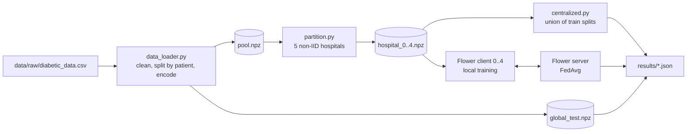

# Federated Learning Across Simulated Hospitals

Big Data course project, <course name>. Team: <Name 1> (data, centralized baseline), <Name 2> (Flower federated training).

Several hospitals want a shared readmission model but cannot move patient records out of their own systems. We simulate five hospitals with non-IID data, then compare **centralized** training against **federated** training (Flower, FedAvg) on accuracy, communication cost, training time and per-site fairness.

## Status

| Part | Owner | Status |
|---|---|---|
| Data cleaning, patient-grouped split, encoding | <Name 1> | Done |
| Five simulated non-IID hospitals | <Name 1> | Done |
| Shared model, metrics, per-site evaluation | <Name 1> | Done |
| Centralized baseline (single run and 5 seeds) | <Name 1> | Done |
| Epoch selection on validation data (8 epochs) | <Name 1> | Done |
| Results notebook (centralized), data card | <Name 1> | Done |
| Flower server/clients, FedAvg, logging, checkpoints | <Name 2> | **To do** |
| Federated runs over 5 seeds | <Name 2> | **To do** |
| Federated vs. centralized comparison, per-site fairness analysis | both | To do |
| Model card, technical report, demo video | both | To do |

## Architecture



## Dataset

[Diabetes 130-US Hospitals for Years 1999-2008](https://archive.ics.uci.edu/dataset/296/diabetes-130-us-hospitals-for-years-1999-2008) (UCI), licensed CC BY 4.0. Source: Strack et al., 2014. Task: predict readmission within 30 days (`readmitted == "<30"` is 1, otherwise 0). About 11% of encounters are positive. Details are in [`DATA_CARD.md`](DATA_CARD.md).

The dataset has **no hospital ID column**, so the five hospitals are *simulated* (see `src/partition.py`).

## Setup (Windows, PowerShell, VS Code)

Use **Python 3.12** (both team members must use the same minor version).

```
git clone https://github.com/sunidhishekar-create/federated-learning-on-hospital-data-.git
cd federated-learning-on-hospital-data-
python -m venv .venv
.venv\Scripts\Activate.ps1
pip install -r requirements.txt
```

If PowerShell blocks activation, run `Set-ExecutionPolicy -Scope CurrentUser RemoteSigned` once. In VS Code select the interpreter with `Ctrl+Shift+P` > Python: Select Interpreter > `.venv`.

Download the dataset from the link above and put `diabetic_data.csv` and `IDS_mapping.csv` into `data/raw/` (gitignored).

## Reproduce Part 1

```
python -m src.prepare        # clean, split, encode, build 5 hospitals (~10 s)
python -m src.centralized    # single baseline run (seed 42, ~25 s) -> results/centralized.json
python -m src.multiseed      # 5-seed baseline (~2 min) -> results/centralized_seeds.json
```

Everything is seeded (`seed` and `eval_seeds` in `configs/config.yaml`), so results reproduce exactly. A fresh clone gave identical data and partitions.

**Check your setup:** after `src.prepare` and `src.centralized`, the output must show **ROC-AUC 0.6781** on the global test set and a partition table with hospital sizes 13,586 / 23,965 / 10,273 / 9,026 / 22,717. If not, stop and tell <Name 1> before building anything on top.

## Project structure

```
configs/config.yaml        shared settings (see ownership rules below)
data/raw/                  downloaded CSVs (gitignored)
data/processed/            generated .npz files (gitignored)
src/data_loader.py         cleaning, split, encoding, loading functions
src/partition.py           builds the 5 non-IID hospitals
src/prepare.py             one command: split + partition
src/model.py               MLP, get/set weights, training loop
src/metrics.py             metrics, per-site evaluation, fairness gaps
src/centralized.py         centralized baseline (one run)
src/multiseed.py           centralized baseline over eval_seeds
src/federated/             Flower code (Part 2)
notebooks/01_explore.ipynb              data exploration
notebooks/02_centralized_results.ipynb  centralized results and per-site analysis
notebooks/03_epoch_selection.ipynb      epoch selection on validation data
results/centralized.json          single run (seed 42): metrics, per-site table, loss history
results/centralized_seeds.json    mean and std over eval_seeds, per-site means
results/hospital_partition.csv    table of the simulated hospitals
results/figures/           plots used in the report
results/checkpoints/       model checkpoints (gitignored)
DATA_CARD.md               data card
```

## Data pipeline

1. **Cleaning.** Drop `weight` (97% missing) and `payer_code` (40% missing). Drop encounters ending in death or hospice (they cannot be readmitted). Group ICD-9 diagnosis codes into broad categories. Keep the 10 most common `medical_specialty` values and group the rest as "Other".
2. **Global test set.** 20% of *patients* (grouped by `patient_nbr`) are held out first, so no patient appears in both train and test.
3. **Encoding.** One-hot encoding and standard scaling, **fitted on the training pool only**. Result: 182 features.
4. **Hospital simulation.** Whole patients are assigned to hospitals. Patients are grouped by age band and readmission label, and a Dirichlet draw (`dirichlet_alpha: 1.0`) decides each group's share per hospital. This creates feature skew (age mix), label skew (readmission rate) and quantity skew (hospital size). A draw is rejected if a hospital has under 5% or over 45% of the data, under 200 positives, or a positive rate outside 4% to 25%.
5. **Validation sets.** Each hospital holds out 10% of its own patients, so validation matches its own distribution. Validation data is never used for training.

### Simulated hospitals

| Hospital | Rows | Train | Val | Positive rate | % age <50 | % age 50-69 | % age 70+ |
|---|---|---|---|---|---|---|---|
| 0 | 13,586 | 12,320 | 1,266 | 22.4% | 5.7% | 54.6% | 39.8% |
| 1 | 23,965 | 21,571 | 2,394 | 6.8% | 14.7% | 31.6% | 53.7% |
| 2 | 10,273 | 9,162 | 1,111 | 24.8% | 14.9% | 45.3% | 39.8% |
| 3 | 9,026 | 8,173 | 853 | 8.4% | 13.0% | 75.7% | 11.3% |
| 4 | 22,717 | 20,496 | 2,221 | 4.8% | 25.0% | 21.2% | 53.8% |

Also saved in `results/hospital_partition.csv`. The test set and the hospitals are fixed by `seed: 42`. Never change `seed`, `dirichlet_alpha` or the hospital settings after this point without re-running the baseline and telling the whole team, because every comparison depends on identical data.

## Model

One PyTorch MLP, used by **both** centralized and federated training: 182 → 64 → 32 → 1 (ReLU, dropout 0.2), 13,825 parameters. Loss is `BCEWithLogitsLoss` with `pos_weight` (negatives / positives) to handle class imbalance. Adam, learning rate 0.001, batch size 64. All values come from `configs/config.yaml`.

**Training budget.** The model overfits: training loss keeps falling, but ROC-AUC on held-out data peaks early. The epoch count (8) was therefore chosen on the **pooled validation sets of the five hospitals**, not on the test set (`notebooks/03_epoch_selection.ipynb`). Validation ROC-AUC by epochs: 3 → 0.666, 5 → 0.670, 8 → 0.672, 10 → 0.665, 15 → 0.659, 20 → 0.649, 30 → 0.635. The federated run uses the matching budget of **8 rounds with 1 local epoch each**.

## Shared interface (for the Flower side)

```python
from src.data_loader import load_config, load_hospital_data, load_global_test, get_input_dim
from src.model import build_model, get_weights, set_weights, train, predict_proba
from src.metrics import evaluate, evaluate_per_site, fairness_gaps, compute_metrics
```

| Function | Returns / does |
|---|---|
| `load_config()` | Dict from `configs/config.yaml`. |
| `load_hospital_data(i)` | `(X_train, y_train, X_val, y_val)` numpy arrays for hospital `i` (0 to 4). Each Flower client loads only its own. |
| `load_global_test()` | `(X_test, y_test)`. Both approaches are scored on this. |
| `get_input_dim()` | 182. |
| `build_model(input_dim, cfg)` | Fresh MLP. |
| `get_weights(model)` | List of 6 numpy arrays in a fixed order, the format Flower sends. |
| `set_weights(model, weights)` | Loads that list back into a model (exact round trip, tested). |
| `train(model, X, y, epochs, lr, batch_size, cfg, seed)` | Trains in place, returns the model. Per-epoch loss in `model.loss_history`. Builds a fresh Adam optimizer on every call. |
| `predict_proba(model, X)` | Positive-class probabilities. |
| `evaluate(model, X, y)` | Dict: accuracy, precision, recall, f1, roc_auc, n, n_pos. |
| `evaluate_per_site(model, range(5), with_ci=True)` | Same metrics on each hospital's validation set (plus a 95% bootstrap interval for ROC-AUC). |
| `fairness_gaps(per_site)` | Max minus min of each metric across hospitals. |
| `compute_metrics(y_true, y_prob)` | Metrics from labels and probabilities (use it if you aggregate predictions yourself). |

Do not edit these files without telling <Name 1>. If you need a change (for example a different return format), ask for it, so the centralized baseline stays comparable.

## Config ownership

`configs/config.yaml` is shared.

- <Name 1> edits everything except `federated:` and `eval_seeds`.
- <Name 2> edits **only** the `federated:` section. Set `num_rounds: 8` and `local_epochs: 1` (the file currently says 20, which must be changed to match the centralized budget).
- `eval_seeds: [42, 43, 44, 45, 46]` is shared and fixed. Both sides use it for multi-seed runs.
- If a shared value must change (learning rate, batch size, hospital settings), agree on it first, because it changes the baseline too.

## Part 1 results (centralized baseline)

Trained on the union of the five hospitals' training splits (71,722 rows) for 8 epochs. Mean ± std over 5 seeds (`results/centralized_seeds.json`). The single run in `results/centralized.json` is seed 42 (ROC-AUC 0.6781).

| Metric (global test set, 19,773 rows) | Mean ± std |
|---|---|
| Accuracy | 0.6268 ± 0.0338 |
| Precision | 0.1767 ± 0.0070 |
| Recall | 0.6217 ± 0.0475 |
| F1 | 0.2746 ± 0.0032 |
| ROC-AUC | **0.6778 ± 0.0008** |
| Training time | 19.4 ± 1.3 s (CPU, training only) |

**Per-site results** (each hospital's validation set, mean ± std over seeds):

| Hospital | ROC-AUC | Recall |
|---|---|---|
| 0 | 0.619 ± 0.007 | 0.591 ± 0.060 |
| 1 | 0.698 ± 0.006 | 0.668 ± 0.054 |
| 2 | 0.625 ± 0.004 | 0.654 ± 0.038 |
| 3 | 0.623 ± 0.019 | 0.525 ± 0.045 |
| 4 | 0.665 ± 0.009 | 0.600 ± 0.043 |

Per-site ROC-AUC gap (max minus min): **0.083 ± 0.009**. Precision and F1 gaps are large (about 0.25 and 0.31) mainly because the hospitals' base rates differ.

**How to read this.** ROC-AUC is very stable across seeds (std 0.0008), so even a small federated difference is detectable. Recall and accuracy depend on the fixed 0.5 threshold and move by ±0.03 to 0.05 between seeds, so single runs of those cannot be compared. Per-site numbers are noisier than the global ones, especially hospital 3 (56 positive validation cases).

## To do: Part 2 (Flower), <Name 2>

Work on branch `feature/flower-fl`, in `src/federated/` and the `federated:` section of the config.

### First hour checklist

1. `git checkout main`, `git pull`, `git checkout -b feature/flower-fl`.
2. Follow the Setup section. Create the venv, `pip install -r requirements.txt` (takes several minutes; Ray comes with `flwr[simulation]`).
3. Put the two CSVs in `data/raw/`, then run `python -m src.prepare` and `python -m src.centralized`. Check the numbers listed under "Check your setup".
4. Open `notebooks/02_centralized_results.ipynb` to see the target numbers you will be compared against.
5. Set `federated.num_rounds: 8` and `local_epochs: 1` in the config.
6. Report any setup problem to <Name 1> right away.

### What to build

1. **Flower server and five clients** (simulation is fine; Flower's simulation runtime is the default for `flwr run`). Client `i` loads its data with `load_hospital_data(i)`. Flower's recommended structure is a `ServerApp` and a `ClientApp` run with `flwr run`. The API has changed between Flower versions, so follow the documentation for the installed version (`flwr==1.42.0`), for example `flwr new @flwrlabs/quickstart-pytorch`, and not older tutorials. Keep the Flower app files in `src/federated/`. The app must be able to `import src...`: run from the project root, and if the imports fail, install the project in editable mode or add the root to the path.
2. **Local training** in each client with the shared `train()`, `get_weights()` and `set_weights()`. Pass a different seed each round and client (for example `seed + round * 10 + client_id`), otherwise every round shuffles the data identically.
3. **FedAvg aggregation**, weighted by number of training samples, for `num_rounds` rounds, with all five clients taking part every round (`fraction_fit: 1.0`, `min_available_clients: 5`).
4. **Same initial model as the centralized run.** Call `torch.manual_seed(seed)` before `build_model`, with the run's seed, so both methods start from identical weights.
5. **After every round**, evaluate the global model with `evaluate(...)` on `load_global_test()` and with `evaluate_per_site(...)`. Log round, metrics and elapsed time.
6. **Communication cost.** Measure the bytes of model weights sent per round (up and down, all clients). Sanity check: the model has 13,825 float32 parameters, about 55 KB per transfer, so about 0.55 MB per round for 5 clients (10 transfers), and about 4.4 MB over 8 rounds. Your measured value should be close to this, or you can explain the difference (for example serialization overhead).
7. **Total training time**, from the start of the first round to the end of the last. This includes Flower's simulation overhead, so also record the sum of the clients' local training time, so the report can separate computation from overhead. Run on the same machine as the centralized baseline.
8. **Checkpoints and logs.** Save the global model after each round (or at least the last) to `results/checkpoints/` (gitignored) and a per-round log (round, global-test metrics, time, bytes) to `results/`.
9. **Results files.**
   - `results/federated.json`: one run (seed 42), same keys as `results/centralized.json` (`global_test`, `per_site_val`, `fairness_gaps`, `train_seconds`, `n_train`, ...) plus `rounds`, `bytes_per_round`, `total_bytes` and a per-round history. Use `rounds` where the centralized file has `epochs`.
   - `results/federated_seeds.json`: run the whole federated experiment once per seed in `eval_seeds` and store mean and std in the same structure as `results/centralized_seeds.json`. If five runs take too long, use three seeds and say so in the report.
10. **Tuning.** Choose any extra settings (rounds beyond 8, learning rate) on validation data, never on the test set. The main comparison uses the matched budget of 8 rounds. If you also run a longer experiment, report it separately.

### Rules for a fair comparison

- Same model, seed, hyperparameters and data (shared config).
- Comparable effort: centralized uses 8 epochs, federated uses 8 rounds of 1 local epoch each.
- Run federated and centralized on the **same machine**, with nothing heavy running, or the timing comparison is unfair.
- Class weights: centralized computes `pos_weight` from the combined data, each federated client from its own data. This is a natural consequence of federated training. Mention it in the report.
- The optimizer is rebuilt in every local training call, so Adam's state is not carried across rounds. This is standard for FedAvg; mention it.
- Compare **means over seeds**, not single runs. ROC-AUC is the headline metric. Recall and accuracy vary by ±0.03 to 0.05 across seeds, so only treat differences larger than that as real.
- Per-site: report ROC-AUC and recall as the main fairness metrics. Precision and F1 depend on each hospital's base rate. Per-site validation sets are small (hospital 3 has about 56 positives), so differences smaller than the seed spread or the bootstrap intervals should not be called significant.
- Per-site validation numbers and the global test number are measured on different data, so a difference between them is not a fairness gap.

### Done means

- `python -m src.federated.<your entry point>` or `flwr run` reproduces a run from a fresh clone, and the exact commands are written in this README.
- `results/federated.json` and `results/federated_seeds.json` exist and load next to the centralized files.
- The README's "Part 2 results" section is filled in.

## Git workflow

- `main` stays stable. <Name 1> works on `feature/centralized-baseline` (and later feature branches), <Name 2> on `feature/flower-fl`.
- Commit small and often, with messages that describe the change. Open a pull request, and have your teammate review it before merging.
- Before every commit, run `git status --short` and check that no CSV, `.npz`, `.pt` or `.venv` file is listed.
- Checkpoints (`*.pt`, `results/checkpoints/`) are gitignored. If the final zip must contain them, build the zip from the project folder directly.
- If your terminal mangles a long paste, run the commands one at a time.

## Shared deliverables

| Deliverable | Who |
|---|---|
| Comparison notebook (centralized vs. federated, tables and per-site figure) | both; start from `02_centralized_results.ipynb` |
| Model card (architecture, training, metrics, per-site fairness, limitations) | <Name 1> drafts, <Name 2> adds federated rows |
| 3 to 5 page report | <Name 1>: data, hospitals, centralized, fairness method. <Name 2>: federated setup, communication, timing. Both: results and discussion |
| 3-minute demo video (evaluated in class) | about 1 minute each plus 1 minute together on the comparison |

## Deliverables checklist (Option A)

- [x] README with architecture diagram and setup steps (this file)
- [ ] Reproducible pipeline (`prepare`, `centralized`, `multiseed` done; federated run to do)
- [ ] Results notebook (centralized done; federated and comparison to add)
- [ ] 3 to 5 page technical report (comparison report and per-site fairness analysis)
- [x] Data card (`DATA_CARD.md`)
- [ ] Model card
- [ ] 3-minute demo video (evaluated in class)

## Limitations

Hospitals are simulated from one dataset, not real separate sites, and the skew is artificial. Readmission prediction on this dataset is hard (ROC-AUC around 0.62 to 0.68 is typical). Data are from US hospitals, 1999 to 2008. No differential privacy or secure aggregation is used.