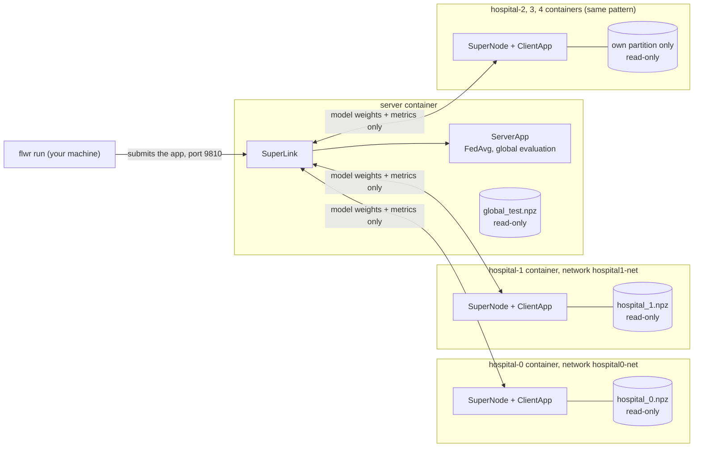
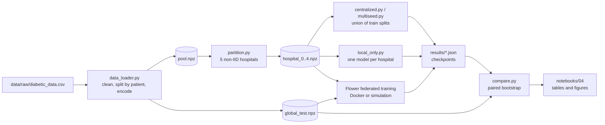

# Federated Learning Across Simulated Hospitals

Big Data course project   
Team: Sunidhi Shekar (data, centralized baseline)   
      Sonia Sharma (Flower federated training, Docker deployment)   
  

Several hospitals want a shared 30-day readmission model but cannot move patient records out of their own systems. We simulate five hospitals with non-IID data from the UCI Diabetes 130-US Hospitals dataset and deploy federated training as **six isolated Docker containers**: one aggregation server and one container per hospital. Each hospital container sees only its own data, and only model weights cross the network.

We compare three approaches on accuracy, communication cost, training time and per-site fairness:

- **centralized** training on pooled data;
- **federated** training with Flower and FedAvg;
- a **local-only** baseline, where each hospital trains alone.

### Key results

Means over 5 seeds; confidence intervals and p-values come from a paired bootstrap with 1,000 draws.

| | Centralized | Federated (Docker deployment) |
|---|---|---|
| Global test ROC-AUC | 0.6777 ± 0.0023 | 0.6699 ± 0.0012 |
| Per-hospital ROC-AUC gap | 0.086 ± 0.009 | 0.089 ± 0.002 |
| Communication, 8 rounds | none | 12.3 ± 0.1 MB measured on the network (6.7 MB of it is model weights) |
| Training time (same Mac) | 5.8 ± 0.5 s | 116 ± 20 s (217 ± 42 s end to end) |

- **Accuracy.** Federated learning costs about 0.008 ROC-AUC compared with pooling all data: −0.008 [−0.013, −0.003], p = 0.001. The loss is small but statistically clear.
- **Who loses.** The loss falls mostly on hospital 2 (−0.025, p = 0.001). That result still holds after adjusting for age.
- **Fairness.** The gap between the best and worst hospital does not change significantly (p = 0.75).
- **Why join.** Every hospital's own model generalizes worse to other hospitals' patients than the federated model does: by +0.005 to +0.113 ROC-AUC, all p ≤ 0.05.
- **Isolation.** All five data-isolation checks pass on the running containers.

## Architecture

### Federated deployment (Docker)



Each round, the server sends the global model to every hospital. Each hospital trains one epoch on its own data and sends back updated weights and metric values. The server averages the weights (FedAvg) and scores the new model on the global test set. Details are in [Federated deployment](#federated-deployment-docker-1).

### Data and evaluation pipeline



> **Simulation mode.** The same ServerApp and ClientApps also run in a single process with Flower's simulation runtime (`python -m src.federated.run`). It needs no Docker. It is used for the paired statistical comparison, and it matches the Docker results to within 0.0006 ROC-AUC per seed. See [Simulation mode](#simulation-mode-no-docker).


## Dataset

[Diabetes 130-US Hospitals for Years 1999-2008](https://archive.ics.uci.edu/dataset/296/diabetes-130-us-hospitals-for-years-1999-2008) (UCI), licensed CC BY 4.0. Source: Strack et al., 2014. Task: predict readmission within 30 days (`readmitted == "<30"` is 1, otherwise 0). About 11% of encounters are positive. Details are in [`DATA_CARD.md`](DATA_CARD.md).

The dataset has **no hospital ID column**, so the five hospitals are *simulated* (see `src/partition.py`).

## Setup

Use **Python 3.12** (all team members must use the same minor version). Tested on Windows 11 and macOS (Apple Silicon).

**Windows (PowerShell):**

```
git clone https://github.com/sunidhishekar-create/federated-learning-on-hospital-data-.git
cd federated-learning-on-hospital-data-
python -m venv .venv
.venv\Scripts\Activate.ps1
pip install -r requirements.txt
```

If PowerShell blocks activation, run `Set-ExecutionPolicy -Scope CurrentUser RemoteSigned` once.

**macOS / Linux:**

```
python3.12 -m venv .venv
source .venv/bin/activate
pip install -r requirements.txt
```

In VS Code select the interpreter with `Ctrl+Shift+P` (`Cmd+Shift+P` on macOS) > Python: Select Interpreter > `.venv`.

Download the dataset from the link above and put `diabetic_data.csv` and `IDS_mapping.csv` into `data/raw/` (gitignored).

**For the federated deployment** you also need Docker Desktop:

- Tested on Apple Silicon with Docker 29 and 8 CPUs.
- Docker's default memory (about 4 GB) is just enough if no other containers are running (Settings > Resources). 6 GB or more gives headroom.
- The `flwr` command comes from the venv above.

## Reproduce

### 1. Data and centralized baseline

```
python -m src.prepare        # clean, split, encode, build 5 hospitals (~10 s)
python -m src.centralized    # single baseline run (seed 42, ~25 s) -> results/centralized.json
python -m src.multiseed      # 5-seed baseline (~2 min) -> results/centralized_seeds.json
```

Everything is seeded (`seed` and `eval_seeds` in `configs/config.yaml`), so results reproduce exactly. A fresh clone gave identical data and partitions.

**Check your setup:** after `src.prepare` and `src.centralized`, the output must show **ROC-AUC 0.6781** on the global test set and a partition table with hospital sizes 13,586 / 23,965 / 10,273 / 9,026 / 22,717. If not, stop and tell Sunidhi Shekar before building anything on top.

### 2. Federated training (Docker deployment)

```
python docker/run_experiment.py --seeds 42          # one seed, about 5 min including startup
python docker/run_experiment.py                     # all eval_seeds, about 20 min
python docker/run_experiment.py --down              # same, then stop and remove the containers
```

One command builds and starts the six containers, verifies data isolation, runs FedAvg, measures traffic and memory, and saves everything to `results/docker/`. Step-by-step commands are in [Federated deployment](#federated-deployment-docker-1).

### 3. Local-only baseline and statistical comparison

```
python -m src.federated.run              # simulation runs, all eval_seeds (~5 min) -> results/federated_seeds.json
python -m src.local_only                 # local-only baseline (~40 s) -> results/local_only_seeds.json
python -m src.compare                    # paired bootstrap comparisons -> results/comparison.json
```

- `src.compare` needs per-patient predictions from every model. It therefore loads the simulation's per-round checkpoints and the local-only checkpoints, and retrains the centralized model per seed.
- Before comparing anything, it checks that every recomputed ROC-AUC matches the recorded value (to about 3e-8).
- Then open `notebooks/04_federated_vs_centralized.ipynb` and run all cells. It only reads from `results/`.

**Same-machine baseline.** Timing comparisons are only fair on one machine, so the comparison uses a centralized 5-seed run made on the same Mac as the federated runs, stored as `results/centralized_seeds_mac.json`. The Windows file stays untouched. To recreate the Mac file:

1. Run `python -m src.multiseed`.
2. Copy `results/centralized_seeds.json` to `results/centralized_seeds_mac.json`.
3. Restore the original with `git checkout results/centralized_seeds.json results/centralized.json`.

The two baselines agree on ROC-AUC (0.6777 vs 0.6778).

## Project structure

```
.
├── configs/
│   └── config.yaml                  shared settings (see Config ownership)
├── data/
│   ├── raw/                         downloaded CSVs (gitignored)
│   └── processed/                   generated .npz files (gitignored)
│
├── src/
│   ├── data_loader.py               cleaning, patient split, encoding, loading
│   ├── partition.py                 builds the 5 non-IID hospitals
│   ├── prepare.py                   one command: split + partition
│   ├── model.py                     MLP, get/set weights, training loop
│   ├── metrics.py                   metrics, per-site evaluation, fairness gaps
│   ├── centralized.py               centralized baseline, one run
│   ├── multiseed.py                 centralized baseline over eval_seeds
│   ├── local_only.py                local-only baseline, one model per hospital
│   ├── compare.py                   paired bootstrap, age-adjusted ROC-AUC
│   └── federated/
│       ├── server_app.py            ServerApp: FedAvg, global evaluation, logs, checkpoints
│       ├── client_app.py            ClientApp: local training and evaluation on one hospital
│       ├── client_metrics.py        NumPy-only metrics for the ClientApp
│       └── run.py                   simulation entry point, one run per seed
│
├── docker-compose.yml               1 server + 5 hospital containers, per-hospital mounts and networks
├── docker/
│   ├── Dockerfile                   Flower SuperLink / SuperNode images + project dependencies
│   ├── requirements.txt             container dependencies (CPU PyTorch installed separately)
│   ├── run_experiment.py            start stack, check isolation, run seeds, measure, save
│   ├── measure_memory.py            per-stage memory profile of one ClientApp process
│   ├── check_client_metrics.py      verifies client_metrics.py == metrics.py
│   └── flwr_home/config.toml        Flower CLI connection to the containers
├── pyproject.toml                   Flower app definition (ServerApp, ClientApp, run config)
│
├── notebooks/
│   ├── 01_explore.ipynb                     data exploration
│   ├── 02_centralized_results.ipynb         centralized results, per-site analysis
│   ├── 03_epoch_selection.ipynb             epoch selection on validation data
│   └── 04_federated_vs_centralized.ipynb    federated vs centralized vs local-only, fairness, Docker
│
├── results/
│   ├── docker/                      deployment results, isolation evidence, memory, logs
│   ├── federated.json               federated run, seed 42 (simulation)
│   ├── federated_seeds.json         federated, mean and std over eval_seeds (simulation)
│   ├── federated_runs/              per-seed federated logs with per-round history
│   ├── centralized.json             centralized run, seed 42
│   ├── centralized_seeds.json       centralized, mean and std over eval_seeds (Windows)
│   ├── centralized_seeds_mac.json   same, on the Mac used for the federated runs
│   ├── local_only_seeds.json        local-only baseline over eval_seeds
│   ├── comparison.json              paired bootstrap comparisons
│   ├── hospital_partition.csv       table of the simulated hospitals
│   ├── figures/                     plots used in the report
│   └── checkpoints/                 model checkpoints (gitignored)
│
├── DATA_CARD.md
└── MODEL_CARD.md
```

## Data pipeline

1. **Cleaning.** Drop `weight` (97% missing) and `payer_code` (40% missing). Drop encounters ending in death or hospice (they cannot be readmitted). Group ICD-9 diagnosis codes into broad categories. Keep the 10 most common `medical_specialty` values and group the rest as "Other".
2. **Global test set.** 20% of *patients* (grouped by `patient_nbr`) are held out first, so no patient appears in both train and test.
3. **Encoding.** One-hot encoding and standard scaling, **fitted on the training pool only**. Result: 182 features.
4. **Hospital simulation.** Whole patients are assigned to hospitals. Patients are grouped by age band and readmission label, and a Dirichlet draw (`dirichlet_alpha: 1.0`) decides each group's share per hospital. This creates three kinds of skew:
   - feature skew (age mix);
   - label skew (readmission rate);
   - quantity skew (hospital size).

   A draw is rejected if a hospital has under 5% or over 45% of the data, under 200 positives, or a positive rate outside 4% to 25%.
5. **Validation sets.** Each hospital holds out 10% of its own patients, so validation matches its own distribution. Validation data is never used for training.

### Simulated hospitals

| Hospital | Rows | Train | Val | Positive rate | % age <50 | % age 50-69 | % age 70+ |
|---|---|---|---|---|---|---|---|
| 0 | 13,586 | 12,320 | 1,266 | 22.4% | 5.7% | 54.6% | 39.8% |
| 1 | 23,965 | 21,571 | 2,394 | 6.8% | 14.7% | 31.6% | 53.7% |
| 2 | 10,273 | 9,162 | 1,111 | 24.8% | 14.9% | 45.3% | 39.8% |
| 3 | 9,026 | 8,173 | 853 | 8.4% | 13.0% | 75.7% | 11.3% |
| 4 | 22,717 | 20,496 | 2,221 | 4.8% | 25.0% | 21.2% | 53.8% |

Also saved in `results/hospital_partition.csv`. The test set and the hospitals are fixed by `seed: 42`. Never change `seed`, `dirichlet_alpha` or the hospital settings without re-running the baseline and telling the whole team, because every comparison depends on identical data.

**Known side effect.** Because age band and label are assigned to hospitals separately, age can become a hospital-specific stand-in for the label. Hospital 3 is the extreme case: 0.7% of its 50-69 year olds are readmitted, against 39.5% of its under-50s and 24.1% of its over-70s. In the full dataset, the 50-69 group is readmitted at about the average rate. The per-site analysis corrects for this with an age-adjusted ROC-AUC (see [Part 2 results](#part-2-results-federated-vs-centralized-vs-local-only)).

## Model

One PyTorch MLP, used by **all** training modes (centralized, federated, local-only): 182 → 64 → 32 → 1 (ReLU, dropout 0.2), 13,825 parameters. Loss is `BCEWithLogitsLoss` with `pos_weight` (negatives / positives) to handle class imbalance. Adam, learning rate 0.001, batch size 64. All values come from `configs/config.yaml`.

**Training budget.** The model overfits: training loss keeps falling, but ROC-AUC on held-out data peaks early. The epoch count (8) was therefore chosen on the **pooled validation sets of the five hospitals**, not on the test set (`notebooks/03_epoch_selection.ipynb`).

| Epochs | 3 | 5 | **8** | 10 | 15 | 20 | 30 |
|---|---|---|---|---|---|---|---|
| Validation ROC-AUC | 0.666 | 0.670 | **0.672** | 0.665 | 0.659 | 0.649 | 0.635 |

Federated training uses the matching budget of **8 rounds with 1 local epoch each**. Local-only training uses 8 epochs on each hospital's own data.

## Shared interface

```python
from src.data_loader import load_config, load_hospital_data, load_global_test, get_input_dim
from src.model import build_model, get_weights, set_weights, train, predict_proba
from src.metrics import evaluate, evaluate_per_site, fairness_gaps, compute_metrics
```

| Function | Returns / does |
|---|---|
| `load_config()` | Dict from `configs/config.yaml`. |
| `load_hospital_data(i)` | `(X_train, y_train, X_val, y_val)` numpy arrays for hospital `i` (0 to 4). Each Flower client loads only its own. |
| `load_global_test()` | `(X_test, y_test)`. All approaches are scored on this. |
| `get_input_dim()` | 182. |
| `build_model(input_dim, cfg)` | Fresh MLP. |
| `get_weights(model)` | List of 6 numpy arrays in a fixed order, the format Flower sends. |
| `set_weights(model, weights)` | Loads that list back into a model (exact round trip, tested). |
| `train(model, X, y, epochs, lr, batch_size, cfg, seed)` | Trains in place, returns the model. Per-epoch loss in `model.loss_history`. Builds a fresh Adam optimizer on every call. |
| `predict_proba(model, X)` | Positive-class probabilities. |
| `evaluate(model, X, y)` | Dict: accuracy, precision, recall, f1, roc_auc, n, n_pos. |
| `evaluate_per_site(model, range(5), with_ci=True)` | Same metrics on each hospital's validation set (plus a 95% bootstrap interval for ROC-AUC). |
| `fairness_gaps(per_site)` | Max minus min of each metric across hospitals. |
| `compute_metrics(y_true, y_prob)` | Metrics from labels and probabilities (use it if you aggregate predictions yourself). |

Do not edit these files without telling Sunidhi Shekar. If you need a change (for example a different return format), ask for it, so the centralized baseline stays comparable.

**Changes made for the Docker deployment** (outputs are unchanged): `src/data_loader.py` reads the project root from the `FL_ROOT` environment variable when it is set, so containers can mount data under `/app`. It also imports pandas, scikit-learn and joblib only inside the preprocessing functions, so a hospital container that only loads its `.npz` file does not pay for them in memory. Preprocessing re-run after the change gave byte-identical `.npz` files.


## Part 1 results (centralized baseline)

Trained on the union of the five hospitals' training splits (71,722 rows) for 8 epochs. Mean ± std over 5 seeds (`results/centralized_seeds.json`, Windows). The single run in `results/centralized.json` is seed 42 (ROC-AUC 0.6781).

| Metric (global test set, 19,773 rows) | Mean ± std |
|---|---|
| Accuracy | 0.6268 ± 0.0338 |
| Precision | 0.1767 ± 0.0070 |
| Recall | 0.6217 ± 0.0475 |
| F1 | 0.2746 ± 0.0032 |
| ROC-AUC | **0.6778 ± 0.0008** |
| Training time | 19.4 ± 1.3 s (CPU, training only) |

**Per-site results** (each hospital's validation set, mean ± std over seeds):

| Hospital | ROC-AUC | Recall |
|---|---|---|
| 0 | 0.619 ± 0.007 | 0.591 ± 0.060 |
| 1 | 0.698 ± 0.006 | 0.668 ± 0.054 |
| 2 | 0.625 ± 0.004 | 0.654 ± 0.038 |
| 3 | 0.623 ± 0.019 | 0.525 ± 0.045 |
| 4 | 0.665 ± 0.009 | 0.600 ± 0.043 |

- **Per-site gap.** The ROC-AUC gap (max minus min) is **0.083 ± 0.009**. Precision and F1 gaps are large (about 0.25 and 0.31) mainly because the hospitals' base rates differ.
- **How to read this.** ROC-AUC is very stable across seeds (std 0.0008), so even a small federated difference is detectable. Recall and accuracy depend on the fixed 0.5 threshold and move by ±0.03 to 0.05 between seeds, so single runs of those cannot be compared.
- **Hospital 3.** Per-site numbers are noisier than the global ones, especially hospital 3, which has 56 positive validation cases.

## Part 2: federated training (Flower)

Built with Flower 1.42.0's Message API (`ServerApp` and `ClientApp` in `src/federated/`, declared in `pyproject.toml`). Model, data, hyperparameters, metrics and seeds are those of Part 1; only the training procedure changes.

| Requirement | Implementation |
|---|---|
| Server and five clients | The server container runs the SuperLink and the `ServerApp`. Hospital container `i` runs a SuperNode and the `ClientApp`, which loads only `load_hospital_data(i)` from its own read-only mount. |
| Local training | Shared `train()`, `get_weights()` and `set_weights()`, 1 local epoch per round. The seed is `seed + round * 10 + hospital`, so every round and client shuffles differently. |
| Aggregation | FedAvg weighted by number of training rows. All five clients train and evaluate every round (`fraction_fit: 1.0`, `min_available_clients: 5`). |
| Same start as centralized | `torch.manual_seed(seed)` before `build_model` on the server, so all approaches start from identical weights. |
| Evaluation every round | The server scores the global model on the global test set. Each client scores it on its own validation set (with a 95% bootstrap interval) and returns only the numbers. |
| Communication cost | Model size from Flower's `ArrayRecord.count_bytes()` (56,110 bytes). Per round: 5 downloads + 5 uploads for training (0.56 MB), plus 5 downloads for client evaluation. In Docker, the server's real network bytes are also measured from `/proc/net/dev`. |
| Training time | First round start to last round end, excluding evaluation time. The sum of the clients' local training seconds is recorded too, so computation and framework overhead can be separated. |
| Checkpoints and logs | Global model after every round (`federated_seed<S>_round<R>.pt`). Per-round history (global metrics, per-site metrics, seconds, bytes) in `federated_runs/seed_<S>.json`. Docker writes under `results/docker/`, the simulation under `results/`. |
| Results files | `federated.json` (seed 42) uses the same keys as `centralized.json`, plus `rounds`, `bytes_per_round`, `total_bytes` and `history`. `federated_seeds.json` uses the layout of `centralized_seeds.json`. |
| Tuning | None. The main comparison uses the matched budget of 8 rounds × 1 local epoch; nothing was tuned on the test set. |

## Federated deployment (Docker)

The federated system runs as **separate containers** using Flower's Deployment Engine (SuperLink and SuperNodes, Flower 1.42): one server container and five hospital containers. The architecture diagram is under [Architecture](#architecture).

- **Only weights travel.** Patient rows never leave a hospital container. The server receives only model weights and metric values.
- **Data isolation** (in `docker-compose.yml`):
  - Each hospital container mounts only its own `hospital_<i>.npz` plus `meta.json`, read-only. `meta.json` holds the feature count and names, no patient rows.
  - The server mounts no hospital data, only the global test set it uses to score the shared model.
  - Each hospital is on its own private network that only the server joins, so hospitals cannot reach each other.
  - `docker/run_experiment.py` verifies all of this on the running containers and saves the evidence to `results/docker/isolation_check.json`. All five checks pass.
- **Images.** The Flower base images are extended with the project's dependencies (`docker/Dockerfile`).
  - The Ubuntu variant is used because the default Alpine images cannot install PyTorch.
  - PyTorch comes from the CPU-only wheel index.
  - The app code is sent by `flwr run`. Data and config are mounted, never copied into an image (`.dockerignore` excludes `data/`).
- **Resources.** Each hospital container is limited to 1 CPU, the server to 2.

### Run

The one-command runner is described under [Reproduce](#2-federated-training-docker-deployment). Step by step:

```
docker compose up -d --build                                       # server + 5 hospitals
docker compose logs superlink | grep "Activated node"              # wait for 5 lines
FLWR_HOME=docker/flwr_home flwr run . docker-deployment --run-config "seed=42" --stream
```

- `FLWR_HOME=docker/flwr_home` points the Flower CLI at the containers (`docker/flwr_home/config.toml`, SuperLink on `127.0.0.1:9810`) without touching your own `~/.flwr`.
- Results go to `results/docker/federated_runs/seed_<seed>.json`.
- Port 9810 is used because 8000 is often taken. Change it in both `docker-compose.yml` and `docker/flwr_home/config.toml` if needed.

### Stop and clean up

```
docker compose down                                  # stop and remove the 6 containers and 5 networks
docker image rm hospital-fl-superlink:1.42.0 hospital-fl-supernode:1.42.0   # about 2.4 GB each
docker image rm flwr/superlink:1.42.0-py3.13-ubuntu24.04 flwr/supernode:1.42.0-py3.13-ubuntu24.04
docker builder prune                                 # optional: build cache
```

No named volumes are created. Results stay in `results/docker/`; model checkpoints there are gitignored (`*.pt`).

### Deployment results

Five seeds (42 to 46), 8 rounds, on a MacBook with a Docker VM of 8 CPUs and 3.8 GiB. Details and plots are in `notebooks/04_federated_vs_centralized.ipynb`, section 8.

| Metric (global test set) | Docker deployment |
|---|---|
| ROC-AUC | 0.6699 ± 0.0012 |
| Recall | 0.639 ± 0.060 |
| Precision | 0.172 ± 0.009 |
| F1 | 0.270 ± 0.006 |
| Accuracy | 0.607 ± 0.046 |
| Per-hospital ROC-AUC gap | 0.089 ± 0.002 |
| Communication, 8 rounds | 12.3 ± 0.1 MB measured at the server (6.7 MB is model weights) |
| Training time, in-app | 116 ± 20 s |
| End to end, incl. app delivery | 217 ± 42 s |

- **Communication.** Real traffic is about 1.8x the weight volume. Round 1 also ships the app code to every hospital (~240 KB each). Every round adds HTTP overhead and the SuperNodes' polling and heartbeats (2.7 KB/s even when idle).
- **Time.** Flower starts a fresh ClientApp process for every message, which imports PyTorch on one CPU before working, and each hospital trains with one thread. The run shows what a real deployment costs; it is not a speed benchmark.
- **Memory.**
  - The stack uses about 1.1 GB when idle. The containers' individual peaks add up to 3.7 GB; that is an upper bound, because the peaks are not simultaneous and include file cache.
  - To fit Docker's default 3.8 GiB, the ClientApp avoids scikit-learn, SciPy and pandas. It uses a NumPy-only copy of the metrics (`src/federated/client_metrics.py`, verified identical by `docker/check_client_metrics.py`), which cuts each client process from 463 to 359 MB.
  - Close other containers before running; with more Docker memory none of this matters.

### Simulation mode (no Docker)

`python -m src.federated.run` runs the same ServerApp and ClientApps in one process with Flower's simulation runtime. Use `--seeds 42` for a single run (~1 min) to `results/federated.json`; with no flag it runs all seeds (~5 min) to `results/federated_seeds.json`.

It is used for the paired statistical comparison below. It matches the deployment closely:

| | Simulation | Docker |
|---|---|---|
| Global ROC-AUC | 0.6696 ± 0.0012 | 0.6699 ± 0.0012 |
| Per-hospital ROC-AUC gap | 0.090 ± 0.004 | 0.089 ± 0.002 |
| Training time, in-app | 34 ± 8 s | 116 ± 20 s |

- **Agreement.** Per seed the two differ by at most 0.0006 ROC-AUC.
- **Why not identical.** The containers run Python 3.13 and Linux PyTorch with one thread per hospital, so floating-point sums run in a different order.

## Part 2 results: federated vs. centralized vs. local-only

Five seeds (42 to 46), same Mac (Apple Silicon, CPU only). Federated numbers in this section come from the simulation runs, which supply per-patient predictions from the saved checkpoints. They match the Docker deployment to within 0.0006 ROC-AUC per seed. Full tables, figures and convergence plots are in `notebooks/04_federated_vs_centralized.ipynb`; all numbers are in `results/comparison.json` and the `*_seeds.json` files.

### Comparison protocol

- **Same inputs.** Same model, seeds, hyperparameters and data (shared config). Comparable effort: 8 epochs (centralized, local-only) vs. 8 rounds × 1 local epoch (federated).
- **Same machine.** Federated and centralized timings come from the same machine (`centralized_seeds_mac.json`).
- **Class weights.** Centralized training computes `pos_weight` from the combined data; each federated client and each local-only model computes it from its own data. This is inherent to federated training.
- **Optimizer state.** The optimizer is rebuilt in every local training call, so Adam's state is not carried across rounds (standard for FedAvg).
- **Paired bootstrap** (`src/compare.py`, 1,000 draws):
  - Each draw resamples the rows of a validation set or the test set once and scores all models on those same rows.
  - Differences are averaged over the 5 seeds inside each draw, so intervals cover both seed and sampling noise.
  - p-values are two-sided. With 1,000 draws the smallest reportable value is p = 0.001.
  - Per-hospital tests are judged against a Bonferroni threshold of 0.05 / 5 = 0.01.
- **Headline metrics.** ROC-AUC is the headline metric. Per-site fairness uses ROC-AUC and recall, because precision and F1 mostly reflect each hospital's base rate.
- **Age-adjusted ROC-AUC.** Only pairs of patients in the same age band (<50, 50-69, 70+) are compared, so a model cannot score by learning the simulation's age-to-label shortcut (see [Simulated hospitals](#simulated-hospitals)).

### Global test set (19,773 rows)

| Metric | Centralized | Federated | Federated − centralized [95% CI], p |
|---|---|---|---|
| ROC-AUC | 0.6777 ± 0.0023 | 0.6696 ± 0.0012 | **−0.0081** [−0.0132, −0.0030], p = 0.001 |
| Recall | 0.623 ± 0.040 | 0.640 ± 0.056 | +0.018 [+0.007, +0.028], p = 0.002 |
| Precision | 0.177 ± 0.006 | 0.171 ± 0.007 | |
| F1 | 0.275 ± 0.003 | 0.269 ± 0.004 | |
| Accuracy | 0.627 ± 0.028 | 0.605 ± 0.042 | |

FedAvg ranks patients slightly worse than pooled training: a loss of about 1.2% of ROC-AUC, small but well outside seed noise. The higher recall comes from the threshold, because the averaged model predicts positive more often; it is not a better model.

### Cost

| | Centralized | Federated (simulation) | Federated (Docker) |
|---|---|---|---|
| Communication, 8 rounds | none | 4.49 MB training weights; 6.73 MB incl. evaluation broadcast | 12.3 ± 0.1 MB measured on the network |
| Training time | 5.8 ± 0.5 s | 33.8 ± 8.4 s | 115.7 ± 20 s (216.8 ± 42 s end to end) |
| Summed client compute | n/a | 35.9 ± 26.6 s | 146 s |

- **Communication.** The weight volume equals the estimate in the brief: 56 KB per transfer × 10 transfers per round × 8 rounds. Patient data is never sent.
- **Time.** Federated training is slower because of coordination overhead (rounds, serialization, scheduling, process start-up), not because of extra computation.

### Per hospital (each hospital's own validation set, ROC-AUC, mean over seeds)

| Hospital | Centralized | Federated | Local-only | Federated − centralized [95% CI], p |
|---|---|---|---|---|
| 0 | 0.616 | 0.600 | 0.610 | −0.016 [−0.034, +0.002], p = 0.078 |
| 1 | 0.697 | 0.690 | 0.697 | −0.006 [−0.025, +0.009], p = 0.478 |
| 2 | 0.627 | 0.602 | 0.635 | **−0.025** [−0.040, −0.010], p = 0.001 |
| 3 | 0.619 | 0.644 | 0.889 (shortcut, see below) | +0.025 [−0.003, +0.056], p = 0.078 |
| 4 | 0.665 | 0.655 | 0.650 | −0.010 [−0.029, +0.009], p = 0.338 |

- **Hospital 2** is the only hospital measurably worse off under FedAvg than under pooling. It survives Bonferroni and the age adjustment: −0.026 [−0.043, −0.010], p = 0.001.
- **Hospital 2 and the class weight.** Hospital 2 has the highest readmission rate (24.8%), so its local class weight differs most from the global one.
- **Recall** differences between federated and centralized are not significant at any hospital.

### Fairness across hospitals

| | Centralized | Federated | Local-only |
|---|---|---|---|
| ROC-AUC gap (max − min) | 0.080 | 0.090 | 0.280 (shortcut-inflated) |
| Worst hospital ROC-AUC | 0.616 (h0) | 0.600 (h0) | 0.610 (h0) |
| Age-adjusted gap | 0.127 | 0.127 | 0.117 |
| Age-adjusted worst hospital | 0.585 (h3) | 0.575 (h2) | 0.594 (h3) |

- **No change in the gap.** Federated training neither widens nor narrows the per-hospital gap compared with centralized training: +0.010 [−0.049, +0.046], p = 0.75.
- **Worst-off hospital.** It does not change significantly either: −0.016, p = 0.56.
- **What drives the gap.** It reflects how hard each hospital's patients are to rank (once age is adjusted for, hospital 1 is the easiest in every model), not the training method.

### Note: local-only baseline

`python -m src.local_only` trains each hospital's model on its own data only, with the same 8-epoch budget. This is what a hospital gets if it does not join.

- **On its own patients:** after age adjustment, no hospital is significantly better or worse off alone (all p ≥ 0.17).
- **On patients from all hospitals:** the federated model beats every local model:

| Local model trained on | Its global test ROC-AUC | Federated advantage [95% CI], p |
|---|---|---|
| Hospital 0 | 0.645 | +0.024 [+0.015, +0.034], p = 0.001 |
| Hospital 1 (largest) | 0.665 | +0.005 [+0.000, +0.010], p = 0.046 |
| Hospital 2 | 0.602 | +0.068 [+0.056, +0.080], p = 0.001 |
| Hospital 3 | 0.556 | +0.113 [+0.099, +0.126], p = 0.001 |
| Hospital 4 | 0.641 | +0.029 [+0.022, +0.037], p = 0.001 |

**Hospital 3's local 0.889 is an artifact of the simulation, not a better model.**

- Inside hospital 3, "aged 50-69" almost means "not readmitted". Predicting by age band alone scores about 0.89 there and about 0.50 on real patients.
- Once only same-age patients are compared, the local model drops to 0.594, against 0.620 for the federated model (p = 0.62).


## Limitations

- **Simulated hospitals.** The hospitals are simulated from one dataset, not real separate sites, and the skew is artificial. The partitioning also creates hospital-specific age-to-label shortcuts, most strongly in hospital 3. Per-site results are therefore reported both raw and age-adjusted.
- **Single-machine deployment.** The Docker deployment runs all six containers on one machine. Network latency and bandwidth between real hospitals are not modeled.
- **Small validation sets.** Per-site sets are small (hospital 3 has 56 positive cases), so only large per-site differences can be detected.
- **Hard task.** Readmission prediction on this dataset is hard (ROC-AUC around 0.62 to 0.68 is typical).
- **Old data.** The data come from US hospitals, 1999 to 2008.
- **Untuned hyperparameters.** Only the epoch count was chosen on validation data. The same 8-epoch budget is used for every approach, including local-only models, and was not tuned per hospital.
- **One strategy.** Only FedAvg was tried. Strategies aimed at non-IID data (for example FedProx) or a shared class weight might reduce hospital 2's loss.
- **No formal privacy guarantee.** No differential privacy or secure aggregation is used. Weights can still leak information about training data.
