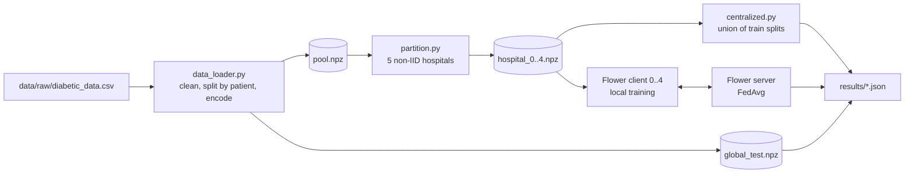

# Federated Learning Across Simulated Hospitals

Big Data course project, <course name>. Team: <Name 1> (centralized baseline, data), <Name 2> (Flower federated training).

Several hospitals want a shared readmission model but cannot move patient records out of their own systems. We simulate five hospitals with non-IID data, then compare **centralized** training against **federated** training (Flower, FedAvg) on accuracy, communication cost, training time and per-site fairness.

## Status

| Part | Owner | Status |
|---|---|---|
| Data cleaning, patient-grouped split, encoding | <Name 1> | Done |
| Five simulated non-IID hospitals | <Name 1> | Done |
| Shared model, metrics, per-site evaluation | <Name 1> | Done |
| Centralized baseline (accuracy, timing) | <Name 1> | Done |
| Flower server/clients, FedAvg, logging | <Name 2> | **To do** |
| Federated vs. centralized comparison, fairness analysis | both | To do |
| Technical report, model/data card, demo video | both | To do |

## Architecture



## Dataset

[Diabetes 130-US Hospitals for Years 1999-2008](https://archive.ics.uci.edu/dataset/296/diabetes-130-us-hospitals-for-years-1999-2008) (UCI), licensed CC BY 4.0. Source: Strack et al., 2014. Task: predict readmission within 30 days (`readmitted == "<30"` is 1, otherwise 0). About 11% of encounters are positive.

The dataset has **no hospital ID column**, so the five hospitals are *simulated* (see `src/partition.py`).

## Setup (Windows, PowerShell, VS Code)

Use **Python 3.12** (both team members must use the same minor version).

```
git clone https://github.com/sunidhishekar-create/federated-learning-on-hospital-data-.git
cd federated-learning-on-hospital-data-
python -m venv .venv
.venv\Scripts\Activate.ps1
pip install -r requirements.txt
```

If PowerShell blocks activation, run `Set-ExecutionPolicy -Scope CurrentUser RemoteSigned` once. In VS Code select the interpreter with `Ctrl+Shift+P` > Python: Select Interpreter > `.venv`.

Download the dataset from the link above and put `diabetic_data.csv` and `IDS_mapping.csv` into `data/raw/` (gitignored).

## Reproduce Part 1

```
python -m src.prepare       # clean, split, encode, build 5 hospitals (~10 s)
python -m src.centralized   # centralized baseline, writes results/centralized.json
```

Everything is seeded (`seed` in `configs/config.yaml`), so results reproduce exactly. A fresh clone gave identical metrics.

## Project structure

```
configs/config.yaml        shared settings (see ownership rules below)
data/raw/                  downloaded CSVs (gitignored)
data/processed/            generated .npz files (gitignored)
src/data_loader.py         cleaning, split, encoding, loading functions
src/partition.py           builds the 5 non-IID hospitals
src/prepare.py             one command: split + partition
src/model.py               MLP, get/set weights, training loop
src/metrics.py             metrics, per-site evaluation, fairness gaps
src/centralized.py         centralized baseline
src/federated/             Flower code (Part 2)
notebooks/                 exploration and results
results/                   JSON results, partition table, checkpoints (gitignored)
```

## Data pipeline

1. **Cleaning.** Drop `weight` (97% missing) and `payer_code` (40% missing). Drop encounters ending in death or hospice (they cannot be readmitted). Group ICD-9 diagnosis codes into broad categories. Keep the 10 most common `medical_specialty` values and group the rest as "Other".
2. **Global test set.** 20% of *patients* (grouped by `patient_nbr`) are held out first, so no patient appears in both train and test.
3. **Encoding.** One-hot encoding and standard scaling, **fitted on the training pool only**. Result: 182 features.
4. **Hospital simulation.** Whole patients are assigned to hospitals. Patients are grouped by age band and readmission label, and a Dirichlet draw (`dirichlet_alpha: 1.0`) decides each group's share per hospital. This creates feature skew (age mix), label skew (readmission rate) and quantity skew (hospital size). A draw is rejected if a hospital has under 5% or over 45% of the data, under 200 positives, or a positive rate outside 4% to 25%.
5. **Validation sets.** Each hospital holds out 10% of its own patients, so validation matches its own distribution. Validation data is never used for training.

### Simulated hospitals

| Hospital | Rows | Train | Val | Positive rate | % age <50 | % age 50-69 | % age 70+ |
|---|---|---|---|---|---|---|---|
| 0 | 13,586 | 12,320 | 1,266 | 22.4% | 5.7% | 54.6% | 39.8% |
| 1 | 23,965 | 21,571 | 2,394 | 6.8% | 14.7% | 31.6% | 53.7% |
| 2 | 10,273 | 9,162 | 1,111 | 24.8% | 14.9% | 45.3% | 39.8% |
| 3 | 9,026 | 8,173 | 853 | 8.4% | 13.0% | 75.7% | 11.3% |
| 4 | 22,717 | 20,496 | 2,221 | 4.8% | 25.0% | 21.2% | 53.8% |

Also saved in `results/hospital_partition.csv`.

## Model

One PyTorch MLP, used by **both** centralized and federated training: 182 → 64 → 32 → 1 (ReLU, dropout 0.2), 13,825 parameters. Loss is `BCEWithLogitsLoss` with `pos_weight` (negatives / positives) to handle class imbalance. Adam, learning rate 0.001, batch size 64. All values come from `configs/config.yaml`.

## Shared interface (for the Flower side)

```python
from src.data_loader import load_config, load_hospital_data, load_global_test, get_input_dim
from src.model import build_model, get_weights, set_weights, train, predict_proba
from src.metrics import evaluate, evaluate_per_site, fairness_gaps, compute_metrics
```

| Function | Returns / does |
|---|---|
| `load_config()` | Dict from `configs/config.yaml`. |
| `load_hospital_data(i)` | `(X_train, y_train, X_val, y_val)` numpy arrays for hospital `i` (0 to 4). Each Flower client loads only its own. |
| `load_global_test()` | `(X_test, y_test)`. Both approaches are scored on this. |
| `get_input_dim()` | 182. |
| `build_model(input_dim, cfg)` | Fresh MLP. |
| `get_weights(model)` | List of numpy arrays in a fixed order (6 arrays), the format Flower sends. |
| `set_weights(model, weights)` | Loads that list back into a model (exact round trip, tested). |
| `train(model, X, y, epochs, lr, batch_size, cfg, seed)` | Trains in place, returns the model. Per-epoch loss in `model.loss_history`. |
| `predict_proba(model, X)` | Positive-class probabilities. |
| `evaluate(model, X, y)` | Dict: accuracy, precision, recall, f1, roc_auc, n, n_pos. |
| `evaluate_per_site(model, range(5), with_ci=True)` | Same metrics on each hospital's validation set (plus a 95% bootstrap interval for ROC-AUC). |
| `fairness_gaps(per_site)` | Max minus min of each metric across hospitals. |

## Config ownership

`configs/config.yaml` is shared. <Name 1> edits everything except the `federated:` section. <Name 2> edits **only** the `federated:` section. If a shared value must change (learning rate, batch size, hospital settings), agree on it first, because it changes the baseline too.

## Part 1 results (centralized baseline)

Trained on the union of the five hospitals' training splits (71,722 rows), 20 epochs.

| Metric (global test set, 19,773 rows) | Value |
|---|---|
| Accuracy | 0.6487 |
| Precision | 0.1785 |
| Recall | 0.582 |
| F1 | 0.2733 |
| ROC-AUC | 0.6616 |
| Training time | about 52 s (CPU) |

Per-site fairness gaps (max minus min across hospitals): accuracy 0.132, precision 0.254, recall 0.131, F1 0.307, ROC-AUC 0.054. Full per-site table in `results/centralized.json`.

## To do: Part 2 (Flower), <Name 2>

Work on branch `feature/flower-fl`, in `src/federated/` and the `federated:` section of the config.

1. Build the Flower server and five clients (simulation is fine). Client `i` loads data with `load_hospital_data(i)`.
2. Local training in each client with the shared `train()` function. Pass a different seed each round (for example `seed + round`), otherwise every round shuffles identically.
3. FedAvg aggregation (weighted by sample count), `num_rounds` rounds from the config.
4. Initialize the global model with the **same seed** as the centralized run (`torch.manual_seed(cfg["seed"])` before `build_model`).
5. After each round, evaluate the global model on `load_global_test()` and with `evaluate_per_site`. Log round, metrics and elapsed time.
6. Measure **communication cost**: bytes of weights sent per round. The model has 13,825 float32 parameters, about 55 KB per direction per client, so roughly 0.55 MB per round for 5 clients (up and down), about 11 MB over 20 rounds. Use this as a sanity check on your measurement.
7. Measure **total training time** from server start to the last round.
8. Save checkpoints and logs to `results/`. Write the final summary to `results/federated.json` in the **same structure as `results/centralized.json`**, so the comparison notebook can load both.

### Rules for a fair comparison

- Same model, seed, hyperparameters and data (shared config).
- Comparable effort: centralized uses 20 epochs, federated uses 20 rounds of 1 local epoch each.
- Run the federated experiment on the **same machine** as the centralized one, or the timing comparison is unfair.
- Class weights: centralized computes `pos_weight` from the combined data, each federated client from its own data. This is a natural consequence of federated training. Mention it in the report.
- Report ROC-AUC and recall as the main fairness metrics. Precision and F1 depend on each hospital's base rate, so they differ even for an identical model.
- Per-site validation sets are small (hospital 3 has about 56 positives), so differences smaller than the confidence intervals should not be called significant.

## Git workflow

- `main` stays stable. <Name 1> works on `feature/centralized-baseline`, <Name 2> on `feature/flower-fl`.
- Commit small and often, open a pull request, and have your teammate review it before merging.
- Checkpoints (`*.pt`, `results/checkpoints/`) are gitignored. If the final zip must contain them, build the zip from the project folder directly.

## Deliverables checklist (Option A)

- [x] README with architecture diagram and setup steps (this file)
- [ ] Reproducible pipeline (scripts: `prepare`, `centralized`, federated run)
- [ ] Results notebook
- [ ] 3 to 5 page technical report (comparison report and per-site fairness analysis)
- [ ] Model and data card
- [ ] 3-minute demo video (evaluated in class)

## Limitations

Hospitals are simulated from one dataset, not real separate sites. Readmission prediction on this dataset is hard (ROC-AUC around 0.62 to 0.68 is typical). No differential privacy or secure aggregation is used.